<p align="center">
  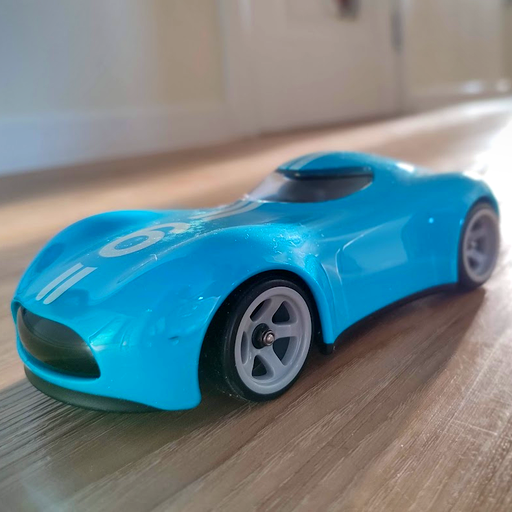
</p>

<h1 align="center">OBD Scanner</h1>

<p align="center">
  <b>A free Android app that reads your car through a cheap ELM327 adapter —<br>
  and turns a drive into a report: engine, fuel, knock, and even the chassis, measured by the phone on the seat.</b>
</p>

<p align="center">
  <a href="https://github.com/parhipov/OBDScanner/releases/latest"></a>
  
  <a href="LICENSE"></a>
</p>

<p align="center"><b>English</b> · <a href="README.ru.md">Русский</a></p>

<p align="center">
  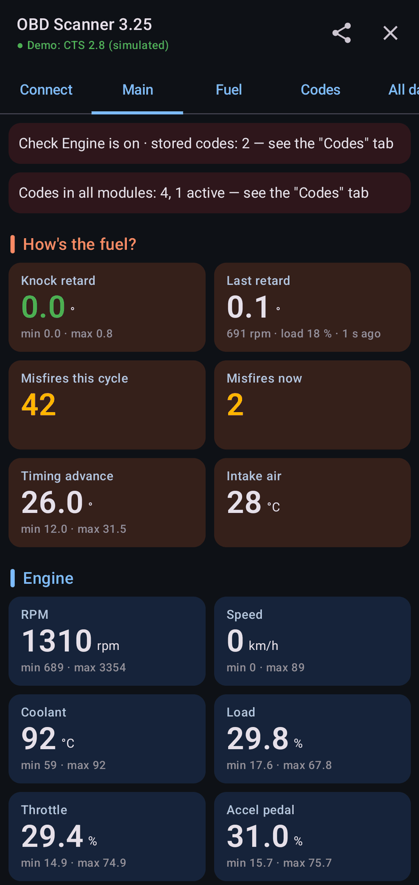
  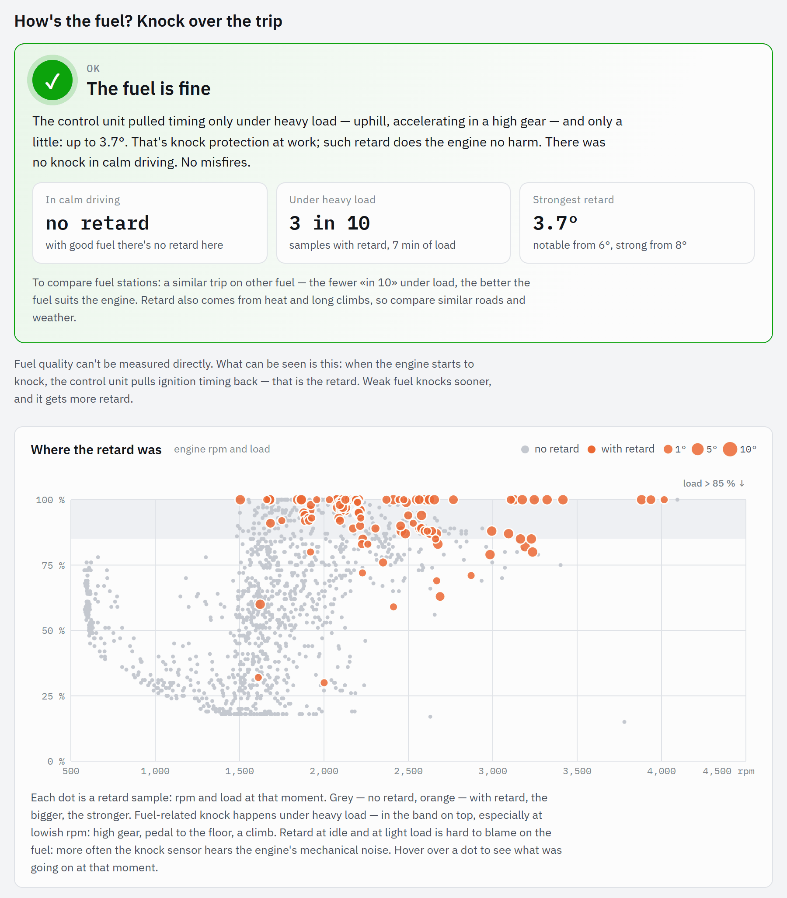
</p>

## Why this one

- **A trip report in one tap.** After «Stop» the phone builds a single HTML page from the recording — no internet, no account. Open it in a browser or send it to a messenger: what to check, trip charts, fuel and knock, the chassis.
- **The chassis, by the phone's own sensors.** Shock absorbers, wheel balance and tyres, brake discs, wheel bearings, driveshaft, engine mounts, torque converter — from the accelerometer and gyroscope. The phone doesn't need a mount: it can lie on the seat.
- **Caught a slide?** If the car stepped out on the drive, the report shows it: when, by how many degrees, how much throttle, whether the wheels spun and how it was caught — from the phone's sensors and the OBD speed, no extra hardware.
- **How's the fuel?** One checkbox, and knock retard is read every cycle: where it happened (rpm × load), how often under heavy load, how strong. Fill up somewhere else, drive the same road, compare.
- **More than standard OBD-II.** Manufacturer parameters and the trouble codes of every module the car lets an ELM327 reach: GM ($22, $A9, GMLAN; with an adapter that knows OBDLink's commands, also the modules on the single-wire bus, pin 1), Toyota ($21), Volkswagen up to ~2012 behind the gateway (VW TP 2.0), UDS and KWP modules of other makes.
- **Knows your car.** 43 makes by VIN, 260+ models and generations: where the connector is, which protocol, which modules and parameters. Over 6,000 manufacturer parameters (most from the open [OBDb](https://github.com/OBDb) project, marked «(?)» until a car confirms them) and almost 12,000 trouble codes explained.
- **Reads, doesn't write.** The only thing it changes in the car is clearing trouble codes (Check Engine and the modules' memory — what you tick) — when you ask and confirm. The app goes online for one thing: checking GitHub for a new version, and that can be turned off.

## The app

<table>
  <tr>
    <td></td>
    <td>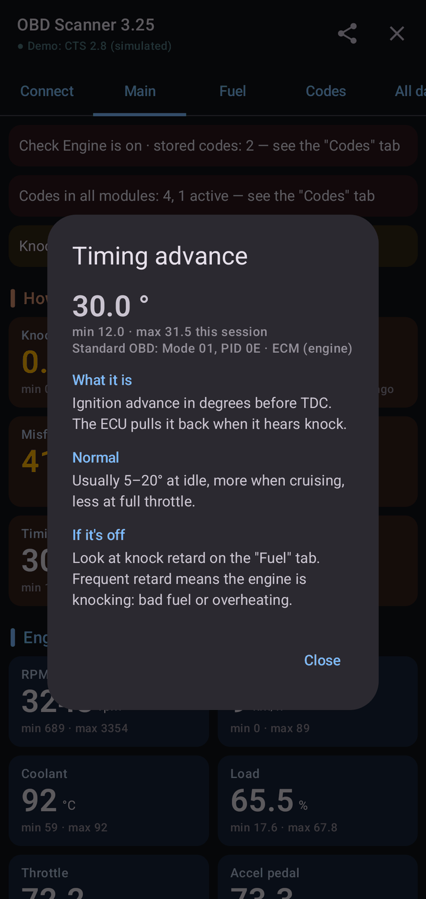</td>
    <td>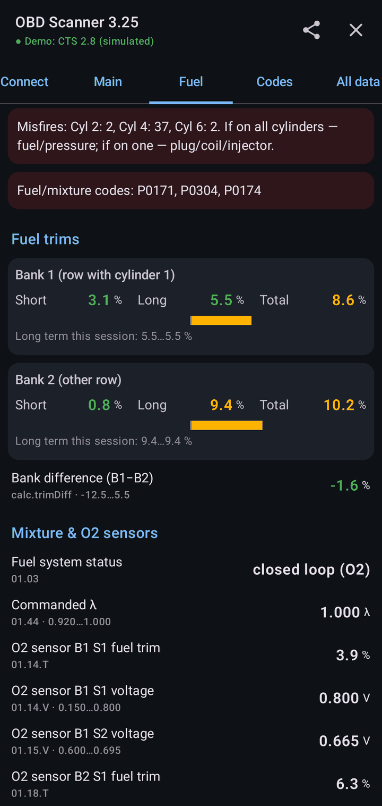</td>
  </tr>
  <tr>
    <td align="center">Main: the key values by section, min/max for the trip; «How's the fuel?» on top</td>
    <td align="center">Tap any card: what it is, what's normal, what to do if it isn't; «Thresholds» sets your own amber and red for this car</td>
    <td align="center">Fuel: trims by bank, O2 sensors, misfires, hints</td>
  </tr>
  <tr>
    <td>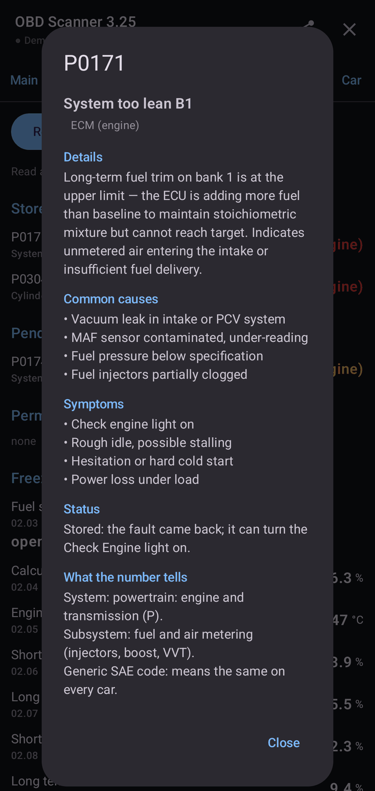</td>
    <td>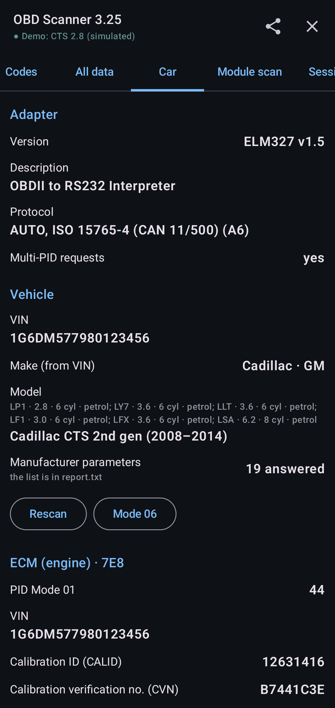</td>
    <td>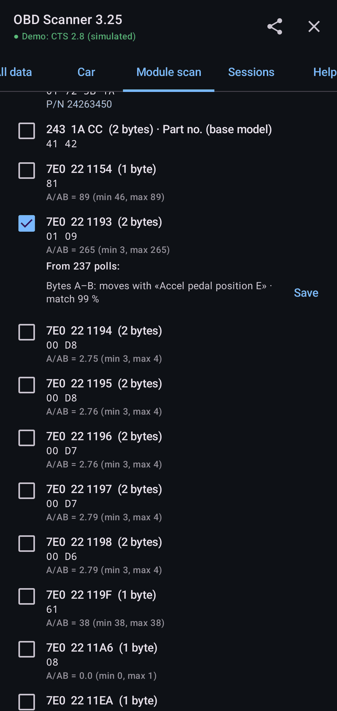</td>
  </tr>
  <tr>
    <td align="center">Codes: tap one — details, causes, symptoms, what the number itself says</td>
    <td align="center">Car: adapter, protocol, VIN, model, modules, readiness, Mode 06</td>
    <td align="center">Module scan: the app compares an unknown value with the standard ones</td>
  </tr>
</table>

Screenshots are from the demo mode — an ELM327 emulator with a Cadillac CTS behind it, built into the app. Try it without a car: «Connect» → «Demo mode» → «Start».

## The trip report

A real 30-minute drive in the developer's Cadillac CTS, the report as the phone built it. The report is in the app's language (English or Russian).

<table>
  <tr>
    <td valign="top" width="50%">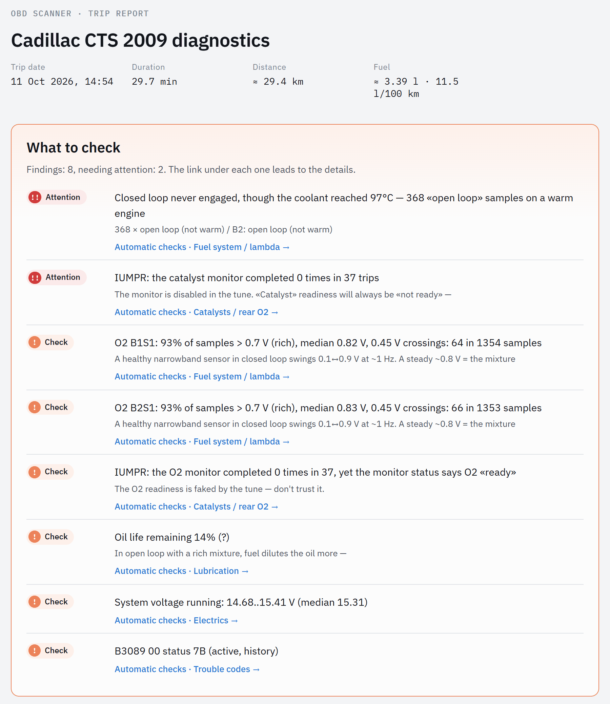</td>
    <td valign="top" width="50%">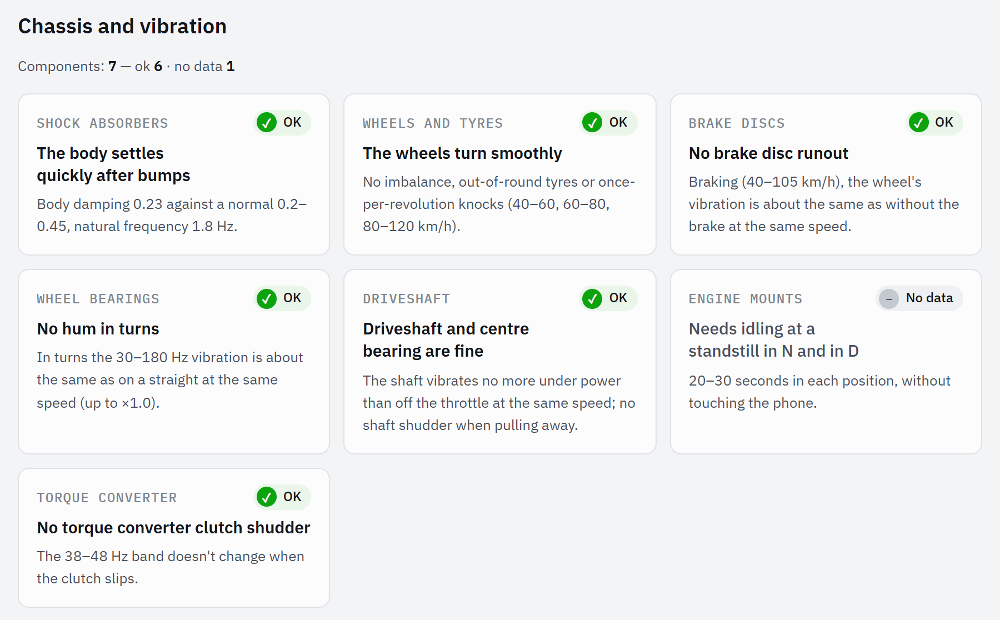</td>
  </tr>
  <tr>
    <td align="center">«What to check»: every finding on top, each with a link to its details</td>
    <td align="center">Chassis and vibration: a verdict for every component</td>
  </tr>
</table>

<p align="center">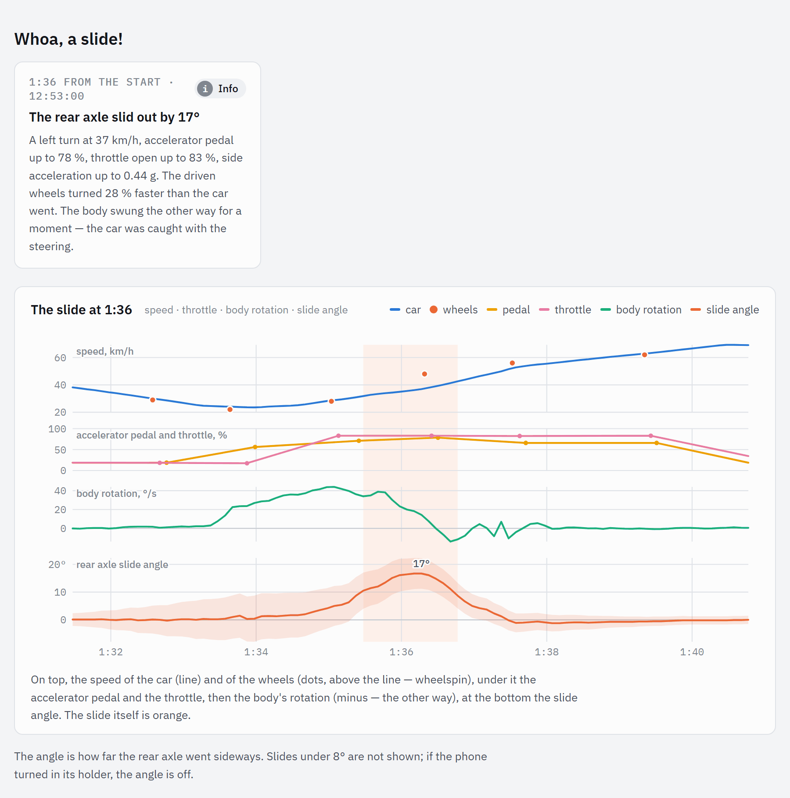</p>
<p align="center">«Whoa, a slide!» — right under «What to check», only when there was one: the angle, the accelerator pedal and the throttle, the wheelspin — and the moment on a chart. Another trip: a left turn with the throttle open to 83 %, the rear axle slid out by 17°, the wheels spun 28 % faster than the car went, the car was caught with the steering</p>

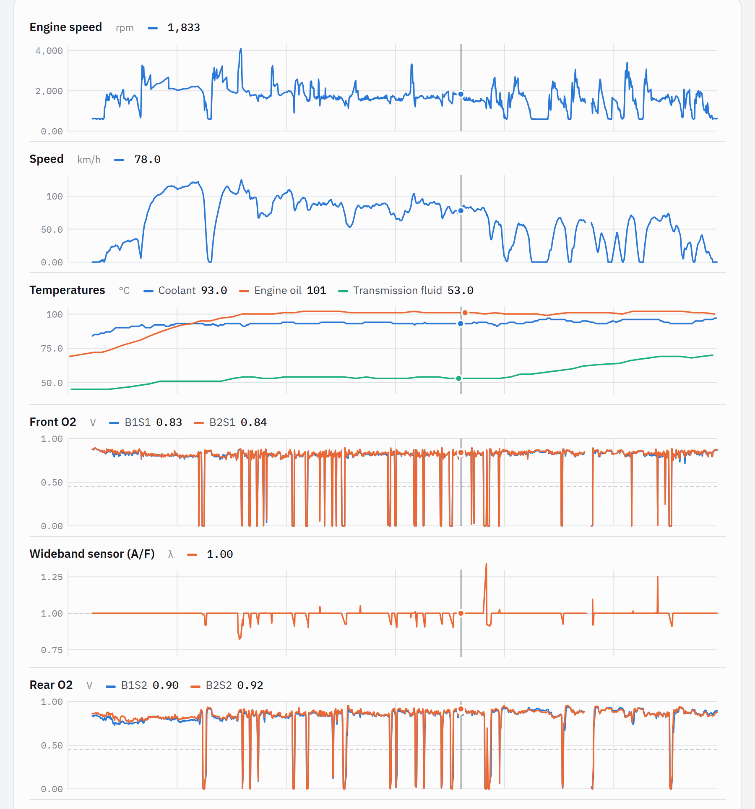
<p align="center">Trip charts with a shared cursor: hover anywhere and every chart shows its value at that moment</p>

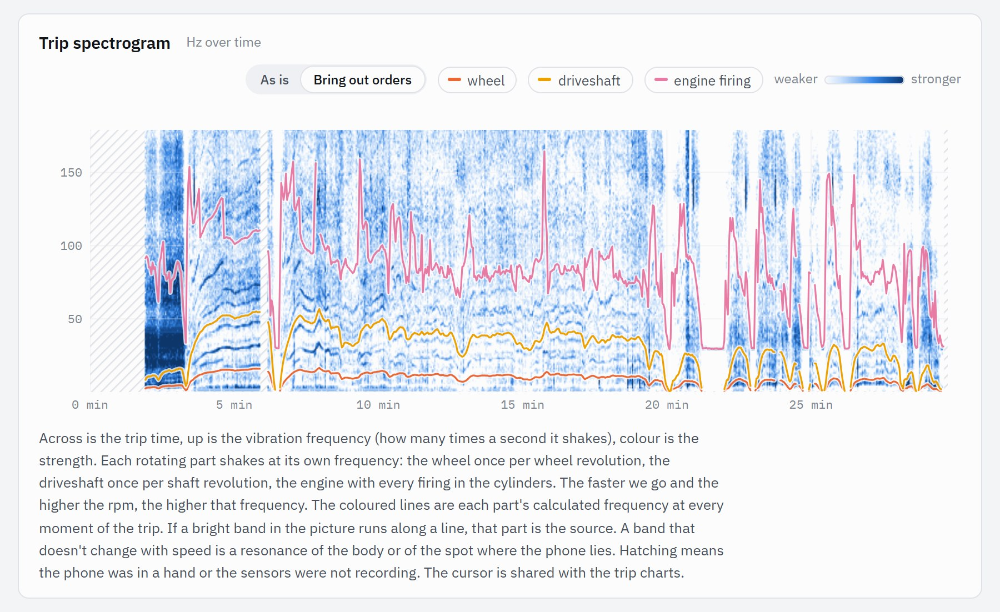
<p align="center">The trip's spectrogram: each rotating part shakes at its own frequency — the coloured lines show where the wheel, the driveshaft and the engine should be</p>

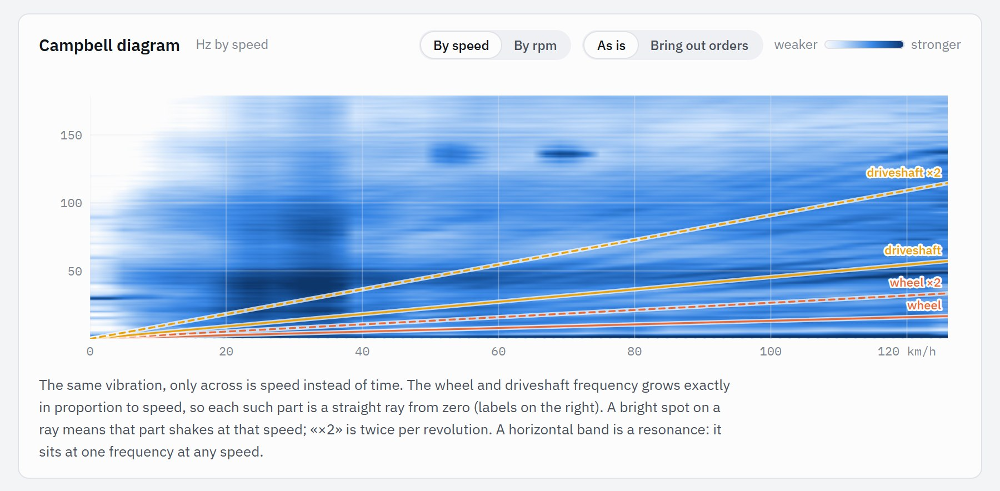
<p align="center">Campbell diagram: the same vibration by speed — a wheel or shaft problem is a bright spot on its ray</p>

What else is in it: the trip's fingerprint (idle, cruise, load — to compare trips with each other), the automatic checks (fuel and lambda, O2 sensors, catalysts, readiness, lubrication, ignition and knock, idle and air, throttle and pedal, transmission, electrics, trouble codes) and the data quality (how many adapter replies came broken). The thresholds are heuristics, not factory limits, and the report says so.

## Real cars, real cases

- **Toyota Crown S180 (Japanese market).** No Mode 01 and no VIN — a standard scanner sees nothing. The app recognises the car by the engine module's own answer (`21 C1` → «GRS18# 4GRFSE») and reads the standard parameters through Toyota's `$21` with the same PID numbers. Worked out from the owner's recording.
- **Chevrolet Trailblazer, GM Korea ([issue #1](https://github.com/parhipov/OBDScanner/issues/1)).** Not in the database at first. From the owner's recordings and their GDS2 notes it now is: recognised by VIN, the modules behind the gateway found with one GMLAN request to all of them, each named as GDS2 names it (power steering, ABS, BCM, radio…).
- **An unknown parameter.** «Module scan» reads what a module answers; tick a value, and after 20 polls the app compares its bytes with the standard PIDs of the same cycle: «looks like RPM = (B·256+C) × 1/4» — or at least what it moves with. Save it, and it is read with everything else, kept by VIN.
- **Volkswagen up to ~2012** (Golf 5/6, Passat B6/B7, Octavia A5…). Behind the gateway the modules speak only VW TP 2.0, which a plain ELM327 can't. The app switches the adapter to raw CAN and runs the channel itself: identification, trouble codes with VAG numbers, measuring blocks. Built from the protocol's description and other implementations and tested on an emulator — **not yet confirmed on a real car**. A recording from one would help a lot.

## Cars

Tested on:

| Car | What works |
|---|---|
| **Cadillac CTS 2008–2014, 2.8 V6** | the developer's car: everything above, every day — GM parameters, the codes of all HS-CAN modules, module scan, bus listening |
| **Toyota Crown S180 (JDM, 4GR-FSE)** | recognised by the engine module's answer, standard parameters through `$21` |
| **Toyota RAV4 2005 (1AZ-FE)** | standard OBD; the engine module's `$21` data (as in Techstream) scanned and recorded for decoding |
| **Volkswagen Polo 9N** | K-line (ISO 14230, 5-baud), standard OBD |
| **Lada Vesta, Hyundai Solaris** | standard OBD plus module search: identification and codes |

Recordings also came from: Cadillac Escalade, Chevrolet Niva, Chevrolet Trailblazer, Ford Focus 2, Hyundai Tiburon, a 2018 Hyundai diesel van, Lada Kalina, Lada Priora, Opel Mokka, Renault Laguna 3, Renault Logan, SsangYong Kyron, Toyota Caldina, Toyota Passo, Volvo S60. Each one is read through, and the app learns from it.

Limits worth knowing:

- On GM, airbags, cluster, radio, climate and tyre pressure sit on single-wire GMLAN (pin 1). An ELM327 can't reach them; that needs an OBDLink MX+.
- Bus listening works on CAN only.
- Standard OBD works on any protocol the adapter speaks; the manufacturer features need a car the database knows or a module that answers the standard way.

## Get started

1. **Download** the APK from [Releases](https://github.com/parhipov/OBDScanner/releases/latest) and install it (Android will ask to allow installing from this source).
2. **An ELM327 adapter** — cheap clones are fine:
   - Bluetooth: the classic kind, not BLE. Pair it in Android's settings, the PIN is usually `1234` or `0000`;
   - USB: through an OTG adapter, the app finds it by itself;
   - Wi-Fi: join the adapter's network (`WiFi_OBDII`, `VLINK`…), no address to type.
3. **Ignition on**, «Connect» → pick the adapter → «Start». The protocol and the port speed are found automatically; make and model come from the VIN (or pick them by hand). Where the connector is — «Help», for each make.
4. **Android Auto** (optional). The app has a car screen: the values you choose, six to a page, each a card in the level's colour with big digits, the unit and a bar showing where the value sits in this drive's range, the range itself under the title; two to four pages are tabs; refreshed every second. Android Auto runs only apps from Google Play, so once: in the Android Auto settings on the phone tap the version line ten times, then in the developer settings turn on «Unknown sources». Open the app on the head unit; the first time it runs, «All data» on the phone gets a car icon next to each value and a «Car screen» group at the top with «Up» / «Down». Nothing chosen — the car shows Main as the phone does. A Wi-Fi adapter doesn't work alongside wireless Android Auto, which takes the phone's Wi-Fi; Bluetooth and USB adapters do.

## Help the project

- **Send a recording from your car**, especially one the app doesn't know yet. Every connection is recorded; «Sessions» → «Send» makes a zip, the developer's address is filled in. That's how new cars get supported. The recording holds the VIN; the report shows it with the last six characters hidden.
- **Open an [issue](https://github.com/parhipov/OBDScanner/issues)**: what car, what you expected, what you got.

## For developers

Kotlin. `core/` — all the logic, Kotlin Multiplatform (JVM for the app and the tests, JavaScript for the browser); `app/` — Android: adapters, a background service, Compose screens that only draw what the core prepared.

```
gradlew assembleDebug                    # APK: app/build/outputs/apk/debug/
gradlew :core:jvmTest testDebugUnitTest  # tests
```

JDK 17 and the Android SDK. The trip report generator is closed source; without it everything builds and works, there's just no «Report» button.

A new car is usually a JSON edit, not code: [tools/cars/SCHEMA.md](tools/cars/SCHEMA.md); trouble codes — [tools/dtc/SCHEMA.md](tools/dtc/SCHEMA.md). The app is MIT ([LICENSE](LICENSE)); third-party data and their licenses — [core/data/licenses](core/data/licenses/licenses.json), in the app under «Help» → «Licenses».
