<p align="center">
  
</p>

<h1 align="center">OBD Scanner</h1>

<p align="center">
  <b>Бесплатное Android-приложение: читает машину через дешёвый адаптер ELM327 —<br>
  и превращает поездку в отчёт: мотор, бензин, детонация и даже ходовая, по датчикам телефона на сиденье.</b>
</p>

<p align="center">
  <a href="https://github.com/parhipov/OBDScanner/releases/latest"></a>
  
  <a href="LICENSE"></a>
</p>

<p align="center"><a href="README.md">English</a> · <b>Русский</b></p>

<p align="center">
  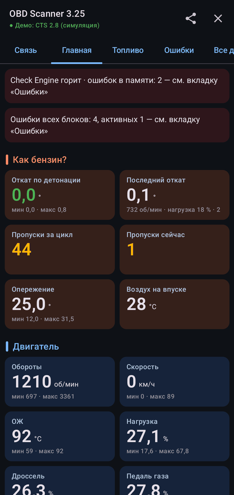
  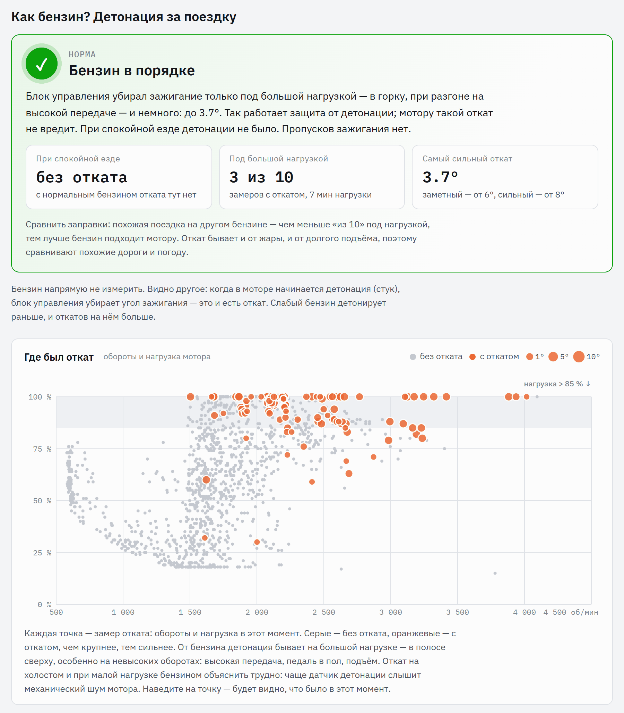
</p>

## Чем отличается

- **Отчёт по поездке в одно касание.** После «Стоп» телефон сам собирает из записи одну HTML-страницу — без интернета и регистрации. Её можно открыть в браузере или отправить в мессенджер: что проверить, графики поездки, бензин и детонация, ходовая.
- **Ходовая — по датчикам самого телефона.** Амортизаторы, балансировка и шины, тормозные диски, ступичные подшипники, кардан, опоры двигателя, гидротрансформатор — по акселерометру и гироскопу. Крепить телефон не нужно: он может лежать на сиденье.
- **Был занос?** Если в поездке машину заносило, отчёт это покажет: когда, на сколько градусов, сколько было газа, буксовали ли колёса и как машину поймали — по датчикам телефона и скорости OBD, без дополнительного железа.
- **Как бензин?** Режим «Топливо» — и откат по детонации читается каждый цикл: где он был (обороты × нагрузка), как часто под большой нагрузкой, насколько сильный. Заправились на другой АЗС, проехали ту же дорогу — сравнили.
- **Контроль безопасности движения.** Режим «Безопасность» для разгонов, поворотов и заносов: обороты, скорость, дроссель и педаль — несколько раз в секунду, остальное редко. Если блок ABS сам передаёт скорости колёс по шине (GM, новые Toyota), приложение их слушает — машине ничего не отправляется — и показывает, когда они сошлись со скоростью по OBD; по разнице передних и задних видна пробуксовка.
- **Больше, чем стандартный OBD-II.** Параметры производителя и коды ошибок всех блоков, до которых ELM327 может дотянуться: GM ($22, $A9, GMLAN; с адаптером, который умеет команды OBDLink, — и блоки на однопроводной шине, контакт 1), Toyota ($21), Volkswagen примерно до 2012 года за шлюзом (VW TP 2.0), блоки других марок по UDS и KWP.
- **Знает вашу машину.** 43 марки по VIN, 260+ моделей и поколений: где разъём, какой протокол, какие блоки и параметры. Больше 6 000 параметров производителей (большая часть — из открытого проекта [OBDb](https://github.com/OBDb), с пометкой «(?)», пока машина их не подтвердит) и почти 12 000 кодов ошибок с объяснениями.
- **Читает, а не пишет.** Единственное, что приложение меняет в машине, — сброс кодов ошибок (Check Engine и память блоков — что отметите), по вашей просьбе и с подтверждением. В интернет оно ходит за одним: узнать у GitHub, нет ли новой версии, и это можно выключить.

## Приложение

<table>
  <tr>
    <td></td>
    <td>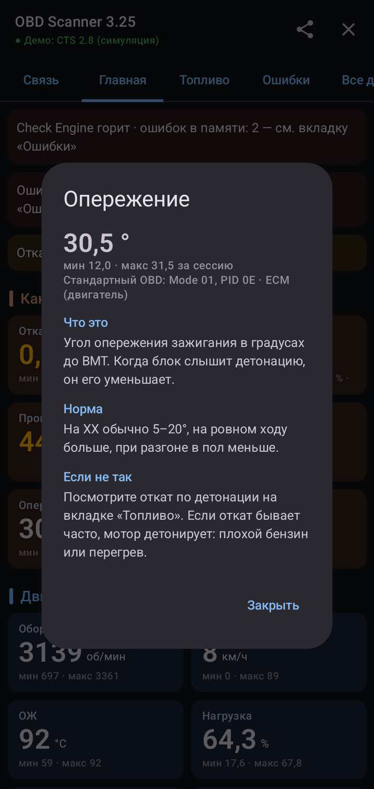</td>
    <td>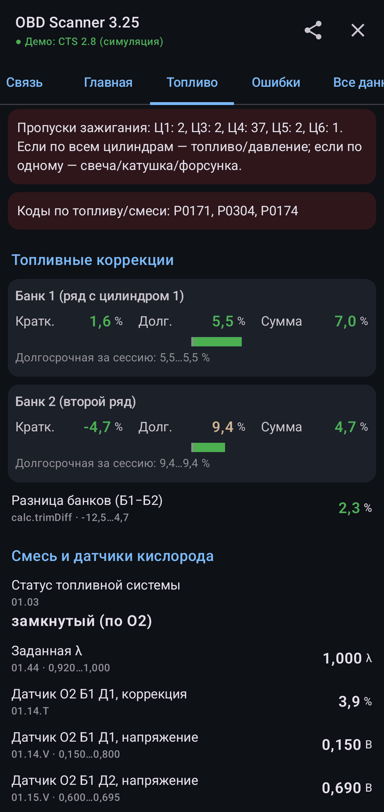</td>
  </tr>
  <tr>
    <td align="center">Главная: основное по секциям, мин/макс за поездку; «Как бензин?» сверху</td>
    <td align="center">Касание карточки: что это, какая норма, что делать, если не так; «Пороги» — свои жёлтый и красный для этой машины</td>
    <td align="center">Топливо: коррекции по банкам, датчики O2, пропуски, подсказки</td>
  </tr>
  <tr>
    <td>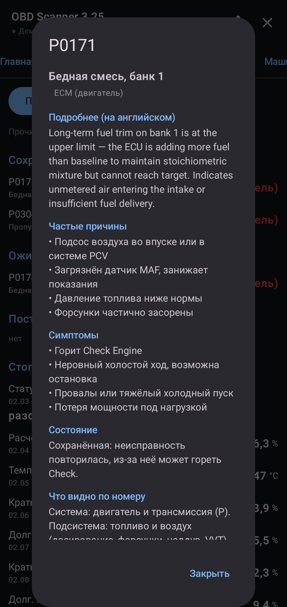</td>
    <td>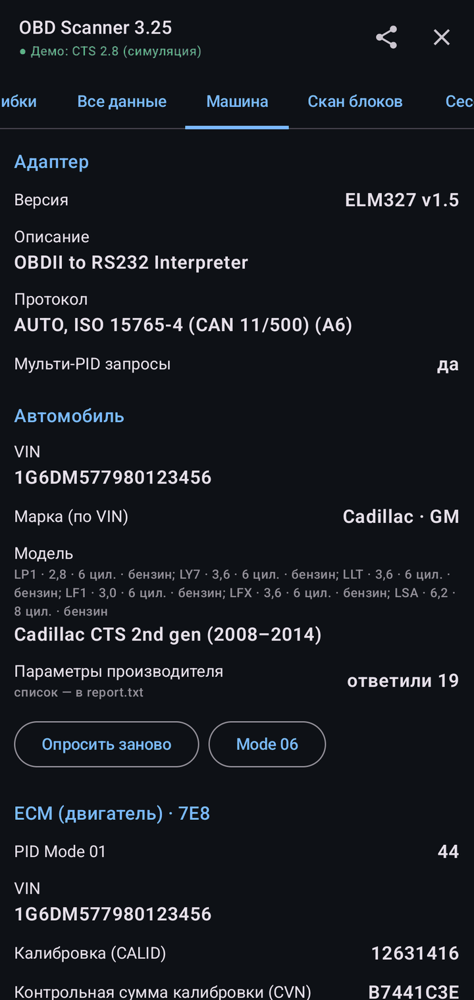</td>
    <td>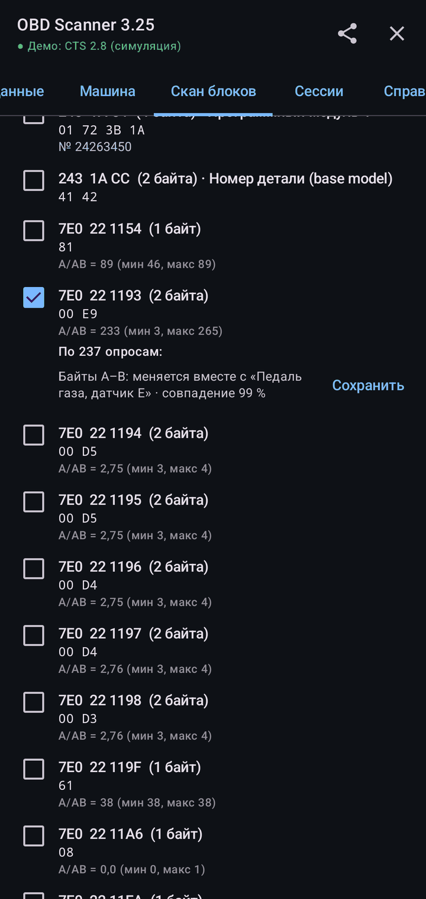</td>
  </tr>
  <tr>
    <td align="center">Ошибки: касание кода — подробности, причины, симптомы, что говорит сам номер</td>
    <td align="center">Машина: адаптер, протокол, VIN, модель, блоки, готовность, Mode 06</td>
    <td align="center">Скан блоков: приложение сверяет неизвестное значение с обычными параметрами</td>
  </tr>
</table>

Скриншоты сняты в демо-режиме — встроенном эмуляторе ELM327 с Cadillac CTS за ним. Попробуйте без машины: «Связь» → «Демо-режим» → «Старт».

## Отчёт по поездке

Настоящая 30-минутная поездка на Cadillac CTS разработчика, отчёт в том виде, в каком его собрал телефон. Отчёт — на языке приложения (русский или английский).

<table>
  <tr>
    <td valign="top" width="50%">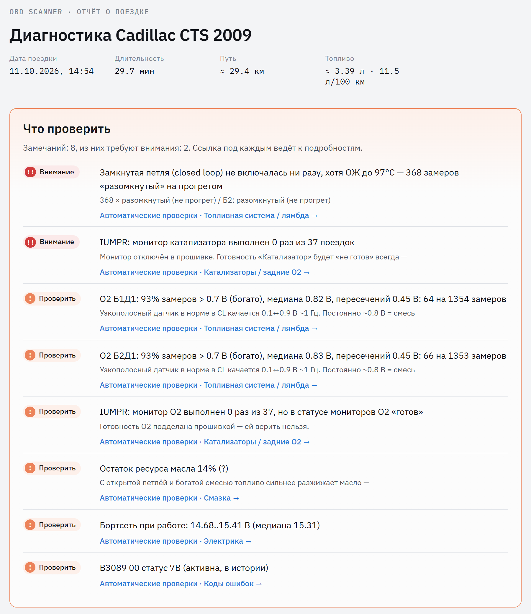</td>
    <td valign="top" width="50%">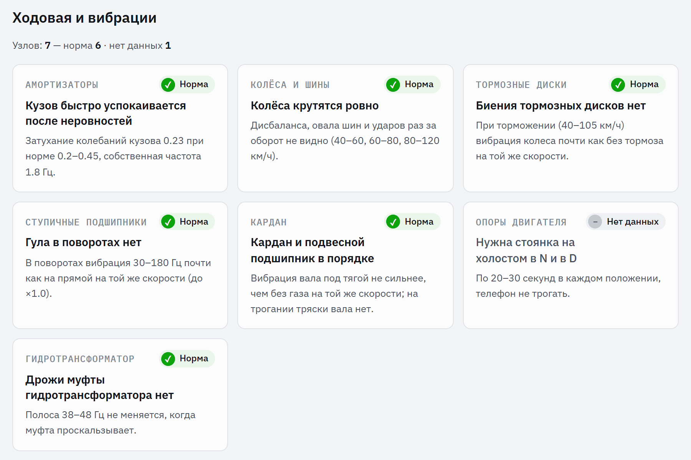</td>
  </tr>
  <tr>
    <td align="center">«Что проверить»: все замечания сверху, у каждого ссылка на подробности</td>
    <td align="center">Ходовая и вибрации: вывод по каждому узлу</td>
  </tr>
</table>

<p align="center">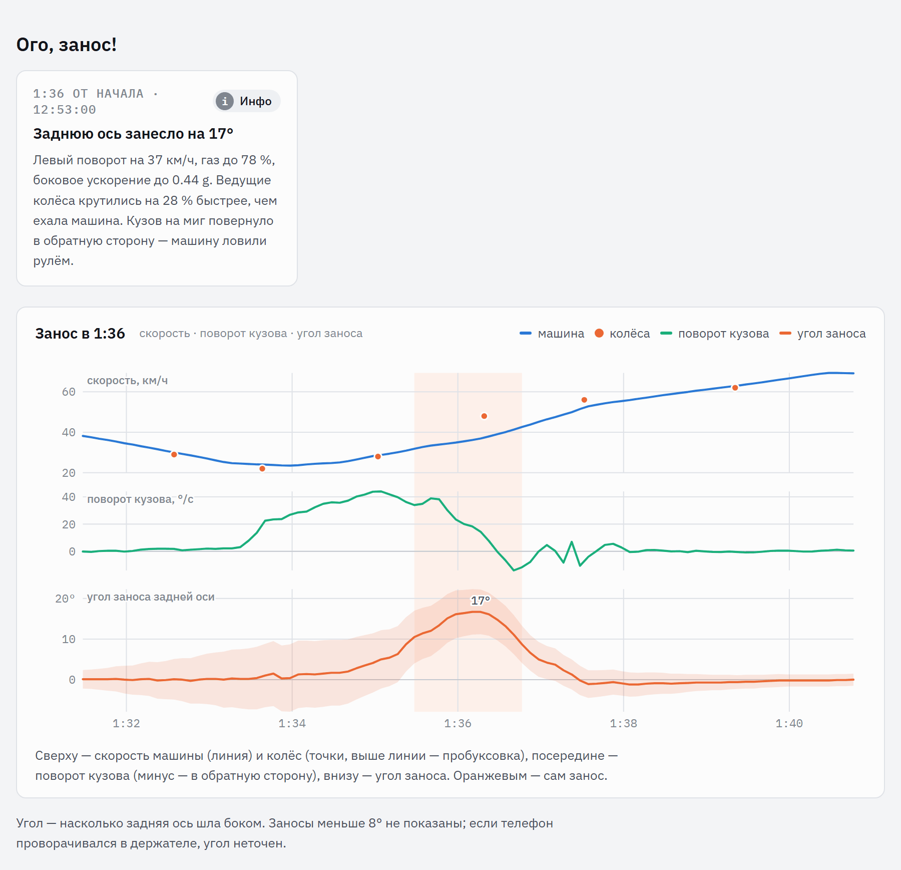</p>
<p align="center">«Ого, занос!» — сразу под «Что проверить», только если он был: угол, педаль газа и дроссель, пробуксовка — и сам момент на графике. Другая поездка: левый поворот, дроссель открыт до 83 %, заднюю ось занесло на 17°, колёса крутились на 28 % быстрее, чем ехала машина, машину поймали рулём</p>

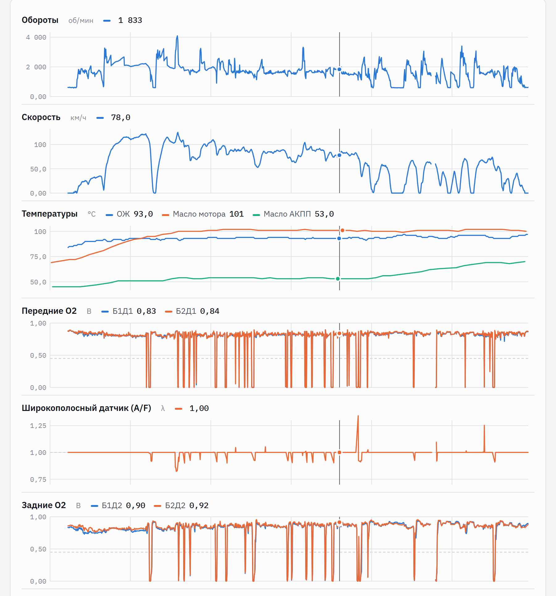
<p align="center">Графики поездки с общим курсором: наведите куда угодно — каждый график покажет своё значение в этот момент</p>

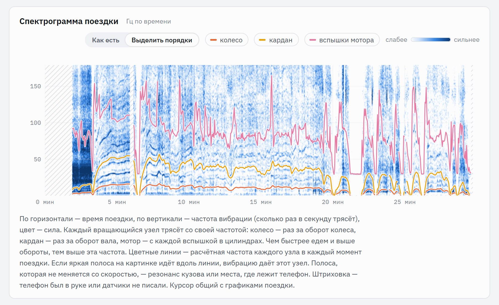
<p align="center">Спектрограмма поездки: каждый вращающийся узел трясёт со своей частотой — цветные линии показывают, где должны быть колесо, кардан и мотор</p>

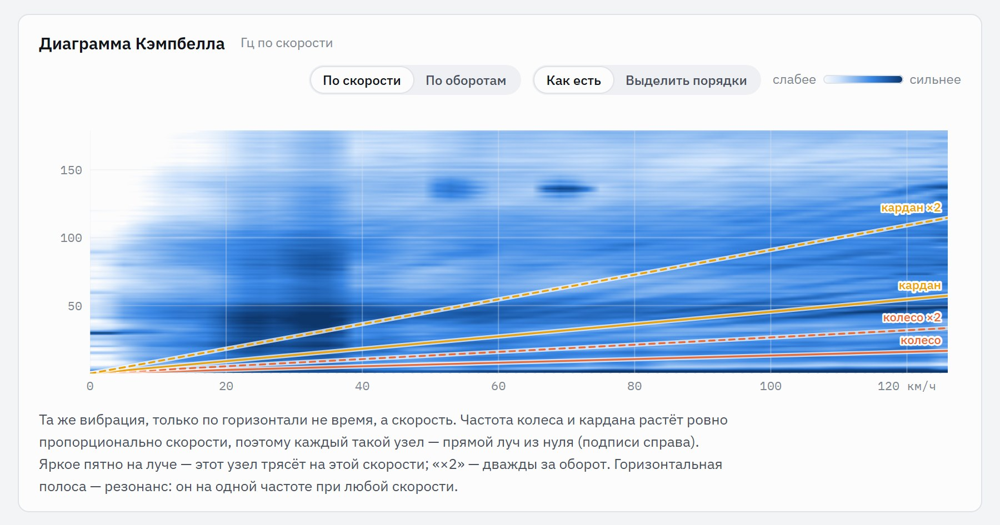
<p align="center">Диаграмма Кэмпбелла: та же вибрация по скорости — неполадка колеса или вала видна яркой точкой на его луче</p>

Что ещё в отчёте: отпечаток поездки (ХХ, круиз, нагрузка — чтобы сравнивать поездки между собой), автоматические проверки (топливо и лямбда, датчики O2, катализаторы, готовность мониторов, смазка, зажигание и детонация, ХХ и воздух, дроссель и педаль, АКПП, электрика, коды ошибок) и качество данных (сколько ответов адаптера пришло битыми). Пороги — эвристики, а не заводские допуски, и отчёт так и пишет.

## Настоящие машины, настоящие случаи

- **Toyota Crown S180 (японский рынок).** Ни Mode 01, ни VIN — обычный сканер не видит ничего. Приложение узнаёт машину по ответу самого блока двигателя (`21 C1` → «GRS18# 4GRFSE») и читает стандартные параметры через тойотовский `$21` с теми же номерами PID. Разобрано по записи владельца.
- **Chevrolet Trailblazer, GM Korea ([issue #1](https://github.com/parhipov/OBDScanner/issues/1)).** Сначала в базе её не было. По записям владельца и его заметкам из GDS2 теперь есть: узнаётся по VIN, блоки за шлюзом находятся одним запросом GMLAN ко всем сразу, каждый назван так, как его называет GDS2 (усилитель руля, ABS, BCM, магнитола…).
- **Неизвестный параметр.** «Скан блоков» читает, что отвечает блок; отметьте значение галочкой — через 20 опросов приложение сверит его байты со стандартными PID того же цикла: «похоже на «Обороты» = (B·256+C) × 1/4» — или хотя бы с чем оно меняется вместе. Сохраните — и оно будет читаться вместе со всем остальным, запомненное по VIN.
- **Volkswagen примерно до 2012 года** (Golf 5/6, Passat B6/B7, Octavia A5…). За шлюзом блоки говорят только по VW TP 2.0, а обычный ELM327 его не умеет. Приложение переводит адаптер в «сырой» CAN и само ведёт канал: идентификация, коды ошибок с номерами VAG, группы измерений. Сделано по описанию протокола и другим реализациям, проверено на эмуляторе — **на настоящей машине пока не подтверждено**. Запись с такой машины очень поможет.

## Машины

Проверено на машинах:

| Машина | Что работает |
|---|---|
| **Cadillac CTS 2008–2014, 2.8 V6** | машина разработчика: всё, что выше, каждый день — GM-параметры, ошибки всех блоков HS-CAN, скан блоков, прослушка шины |
| **Toyota Crown S180 (JDM, 4GR-FSE)** | узнаётся по ответу блока двигателя, стандартные параметры через `$21` |
| **Toyota RAV4 2005 (1AZ-FE)** | стандартный OBD; данные блока двигателя по `$21` (как в Techstream) сканируются и пишутся для расшифровки |
| **Volkswagen Polo 9N** | K-line (ISO 14230, 5-baud), стандартный OBD |
| **Lada Vesta, Hyundai Solaris** | стандартный OBD и поиск блоков: идентификация и ошибки |

Ещё присылали записи: Cadillac Escalade, Chevrolet Niva, Chevrolet Trailblazer, Ford Focus 2, Hyundai Tiburon, дизельный фургон Hyundai 2018 года, Lada Kalina, Lada Priora, Opel Mokka, Renault Laguna 3, Renault Logan, SsangYong Kyron, Toyota Caldina, Toyota Passo, Volvo S60. Каждую разбираем, и приложение учится на ней.

Что стоит знать:

- У GM подушки, приборка, магнитола, климат и давление в шинах — на однопроводной GMLAN (пин 1). ELM327 до них не достаёт, для них нужен OBDLink MX+.
- Прослушка шины — только на CAN.
- Стандартный OBD работает на любом протоколе, который умеет адаптер; возможностям производителя нужна машина из базы или блок, отвечающий стандартным способом.

## Как начать

1. **Скачайте** APK из [Releases](https://github.com/parhipov/OBDScanner/releases/latest) и установите (Android попросит разрешить установку из этого источника).
2. **Адаптер ELM327** — дешёвые клоны подходят:
   - Bluetooth: классический, не BLE. Спарьте его в настройках Android, PIN обычно `1234` или `0000`;
   - USB: через OTG-переходник, приложение найдёт его само;
   - Wi-Fi: подключитесь к сети адаптера (`WiFi_OBDII`, `VLINK`…), адрес вводить не нужно.
3. **Включите зажигание**, «Связь» → выберите адаптер → «Старт». Протокол и скорость порта подбираются сами, марка и модель — по VIN (или выберите вручную). Где разъём — «Справка», для каждой марки.
4. **Android Auto** (по желанию). У приложения есть экран для магнитолы: выбранные значения по шесть на страницу, каждое карточкой цвета уровня с крупными цифрами, единицей и полоской, где значение сейчас в размахе поездки, сам размах под названием; две–четыре страницы это вкладки; обновление раз в секунду. Android Auto запускает только приложения из Google Play, поэтому один раз: в настройках Android Auto на телефоне десять раз нажмите на строку с версией, затем в настройках разработчика включите «Неизвестные источники». Откройте приложение на магнитоле; после первого запуска во «Все данные» на телефоне появится значок машины у каждого значения и группа «Экран машины» сверху со стрелками «Выше» / «Ниже». Ничего не выбрано — машина показывает Главную как на телефоне. Wi-Fi-адаптер не работает вместе с беспроводным Android Auto, оно занимает Wi-Fi телефона; Bluetooth и USB работают.

## Помочь проекту

- **Пришлите запись со своей машины**, особенно если приложение её ещё не знает. Каждое подключение записывается; «Сессии» → «Отправить» соберёт zip, адрес разработчика подставится сам. Так появляется поддержка новых машин. В записи есть VIN; в отчёте последние шесть знаков скрыты.
- **Откройте [issue](https://github.com/parhipov/OBDScanner/issues)**: какая машина, что ожидали, что получили.

### Поддержать разработку

Приложение бесплатное и без рекламы. Поддержать разработку можно донатом по СБП из приложения любого банка или картой: [ссылка](https://pay.cloudtips.ru/p/b487c73c) или QR-код.

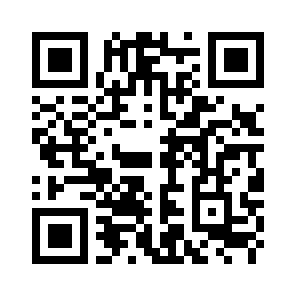

## Разработчикам

Kotlin. `core/` — вся логика, Kotlin Multiplatform (JVM для приложения и тестов, JavaScript для браузера); `app/` — Android: адаптеры, фоновый сервис, экраны на Compose, которые только рисуют то, что подготовило ядро.

```
gradlew assembleDebug                    # APK: app/build/outputs/apk/debug/
gradlew :core:jvmTest testDebugUnitTest  # тесты
```

Нужны JDK 17 и Android SDK. Генератор отчёта по поездке — закрытый; без него всё собирается и работает, только нет кнопки «Отчёт».

Новая машина — обычно правка JSON, а не кода: [tools/cars/SCHEMA.md](tools/cars/SCHEMA.md); коды ошибок — [tools/dtc/SCHEMA.md](tools/dtc/SCHEMA.md). Приложение — MIT ([LICENSE](LICENSE)); данные других авторов и их лицензии — [core/data/licenses](core/data/licenses/licenses.json), в приложении — «Справка» → «Лицензии».
